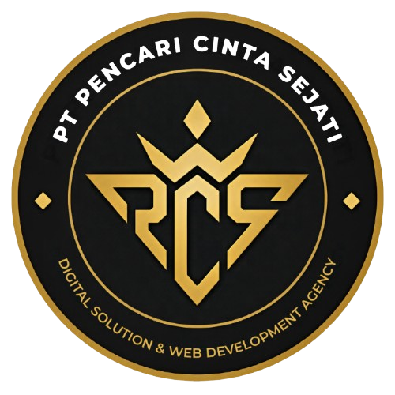

# PCS Edition — Luxury & Supercar Dealer Management System

<p align="center">
  
  <br />
  <strong>PT PENCARI CINTA SEJATI (PCS EDITION)</strong>
  <br />
  <em>The Pinnacle of Luxury Automotive Commerce & Dealership Management</em>
</p>

<p align="center">
  
  
  
  
  
</p>

---

## 🌟 Overview

**PCS Edition** (PT Pencari Cinta Sejati) adalah platform web terpadu untuk showroom supercar dan manajemen dealership otomotif ultra-mewah (*ultra-luxury automotive dealership*). Terinspirasi oleh estetika minimalis dan elegan dari **JamesEdition**, platform ini memadukan katalog eksklusif 55 unit hypercar dari 11 manufaktur ternama dunia dengan sistem operasional dealer lengkap berbasis *Role-Based Access Control* (RBAC).

Sistem mencakup operasional showroom dari hulu ke hilir: mulai dari eksplorasi katalog, reservasi VIP test drive, simulasi kredit, pengajuan asuransi, titip jual (konsinyasi), reservasi servis bengkel tersertifikasi, hingga dashboard manajemen terpadu bagi Super Admin, Sales Representative, Owner, dan Pelanggan.

---

## ✨ Fitur Unggulan

### 1. Showroom & Katalog Eksklusif
* **55 Unit Hypercar & Supercar Autentik:** 5 model unggulan dari 11 brand mewah dunia (*Bugatti, Pagani, Koenigsegg, Ferrari, Lamborghini, Mercedes-AMG, Rolls-Royce, McLaren, Porsche, Aston Martin, Bentley*).
* **Foto Asli Berkualitas Tinggi:** Seluruh 55 unit mobil dilengkapi foto asli beresolusi tinggi yang sesuai dengan tipe dan model kendaraan.
* **Filter Multi-Faset:** Pencarian instan, filter berdasarkan merk (*All Makes*), tahun pembuatan, rentang harga OTR, serta pengurutan berdasarkan harga dan popularitas.
* **Modal Inspeksi & Kalkulator Kredit Interaktif:** Rincian spesifikasi mesin, performa, dimensi, fitur kabin, serta simulasi angsuran bulanan fleksibel (pilihan DP dan tenor hingga 5 tahun).
* **Wishlist / Favorites:** Fitur simpan kendaraan impian dengan penyimpanan lokal (*localStorage*) dan sinkronisasi sesi pengguna.

### 2. Halaman Layanan & Transaksi Mandiri
* **[Service & Maintenance](service.php):** Portal reservasi servis berkala, tuning performa, ganti oli khusus supercar, dan inspeksi 150 titik oleh teknisi tersertifikasi.
* **[VIP Test Drive](testdrive.php):** Formulir pemesanan uji kemudi supercar dengan pemilihan tanggal, slot waktu khusus, dan validasi jadwal bebas bentrok.
* **[Sell Your Car / Konsinyasi](sell.php):** Portal titip jual dan penilaian kendaraan mewah dengan jaminan inspeksi dalam kurun waktu 48 jam kerja.
* **[Insurance Services](insurance.php):** Kalkulator premi asuransi komprehensif khusus supercar dengan estimasi premi instan dan pengajuan polis digital.
* **[Contact & Concierge](contact.php):** Saluran komunikasi privat dengan Sales Advisor & Concierge showroom cabang Jakarta (SCBD) dan Surabaya.

### 3. Portal Manajemen & Dashboard Terpadu (RBAC)
* **Super Admin:** Akses penuh untuk manajemen inventaris mobil (CRUD stok & harga), manajemen user dan hak akses, konversi transaksi SPK, alokasi mekanik servis, serta laporan laba bersih.
* **Sales Representative:** Pipeline prospek (*Leads Management*), pelacakan target penjualan bulanan, konfirmasi jadwal test drive klien, kurasi unit titip jual, dan penanganan tiket pesan.
* **Owner / Investor:** Dashboard keuangan eksekutif *read-only* yang menampilkan omzet penjualan unit, pendapatan servis bengkel, dan performa keuangan terpadu.
* **Customer / User:** Akses ke modal multi-tab *"Riwayat & Aktivitas Saya"* untuk memantau status servis bengkel, reservasi test drive, progress titip jual mobil, serta pesan resmi dengan showroom.

### 4. Resiliensi Offline & Fallback Arsitektur
* **Graceful Degradation:** Jika database MySQL offline atau koneksi terputus, sistem secara otomatis beralih ke *Master In-Memory Catalog* (55 unit dan 11 brand), sehingga angka statistik showroom tidak pernah menampilkan `0` dan katalog tetap dapat dijelajahi dengan lancar.

---

## 🏎️ Katalog 11 Brand & 55 Model Kendaraan

| Brand | Model Utama dalam Galeri |
| :--- | :--- |
| **Bugatti** | Chiron Super Sport, W16 Mistral Roadster, Divo, Bolide Track-Only, Tourbillon V16 |
| **Pagani** | Huayra Roadster BC, Utopia Gated Manual, Huayra R Track Pure, Zonda Cinque, Imola Roadster |
| **Koenigsegg** | Jesko Absolut, Gemera 4-Seater, CC850 Manual Shift, Jesko Attack, Regera DirectDrive |
| **Ferrari** | SF90 Stradale Assetto Fiorano, Purosangue SUV V12, 296 GTB, 812 Competizione, Roma Spider |
| **Lamborghini** | Revuelto V12 Hybrid, Urus Performante, Huracán STO, Temerario V8 Twin-Turbo, Sián FKP 37 |
| **Mercedes-AMG** | AMG GT Black Series, Maybach S 680 V12, AMG G 63 4x4², AMG SL 63 Roadster, AMG ONE F1 |
| **Rolls-Royce** | Phantom VIII Extended, Cullinan Black Badge, Spectre Electric Coupé, Ghost Extended, Dawn |
| **McLaren** | 750S Spider, Senna Ultimate Track Weapon, Artura Spider, 765LT Longtail, McLaren GT |
| **Porsche** | 911 GT3 RS (992), 911 Turbo S, Taycan Turbo GT Weissach, 718 Cayman GT4 RS, Cayenne Turbo GT |
| **Aston Martin** | DB12 Volante Super Tourer, Valkyrie F1 Hypercar, DBX707 Luxury SUV, Vantage F1, DBS 770 Ultimate |
| **Bentley** | Continental GT Speed W12, Bentayga EWB Azure, Flying Spur Mulliner, Batur Coachbuilt, Continental GTC |

---

## 🛠️ Teknologi & Arsitektur

* **Backend:** PHP 8.1+ (Native OOP & Procedural hybrid, PDO Database Driver)
* **REST API:** `api.php` melayani endpoint JSON untuk kalkulator, reservasi, CRUD inventaris, dan otentikasi.
* **Frontend:** Semantik HTML5, CSS3 Modern (Custom Properties / Design Tokens, Flexbox, CSS Grid), Vanilla JavaScript (ES6+ Controllers).
* **Database:** MySQL / MariaDB dengan skema terstruktur (`mobil`, `kategori_brand`, `users`, `servis_booking`, `test_drive`, `titip_jual`, `transaksi`, `asuransi`).
* **Tipografi:** Google Fonts (*Inter* untuk UI body & *Playfair Display* untuk editorial judul mewah).
* **Aset:** File gambar lokal tersimpan di `assets/images/cars/` untuk performa cepat tanpa dependensi CDN luar.

---

## 🚀 Panduan Instalasi & Menjalankan Lokal

### Prasyarat
* [XAMPP](https://www.apachefriends.org/) atau web server sejenis (Apache + PHP 8.0+ dan MySQL).
* Git terpasang di sistem.

### Langkah-langkah Setup:

1. **Clone Repositori:**
   Pindahkan repositori ke folder `htdocs` web server lokal Anda:
   ```bash
   cd c:/xampp/htdocs
   git clone https://github.com/Billierdtya/dealer_mobil.git
   cd dealer_mobil
   ```

2. **Setup Database:**
   * Nyalakan modul **Apache** dan **MySQL** pada XAMPP Control Panel.
   * Buka browser dan akses **phpMyAdmin** (`http://localhost/phpmyadmin`).
   * Buat database baru dengan nama:
     ```sql
     CREATE DATABASE dealer_mobil_db;
     ```
   * Import berkas SQL yang telah disediakan:
     Pilih database `dealer_mobil_db`, klik tab **Import**, lalu pilih file `dealer_mobil_db.sql` (atau `seed.sql`) dan jalankan.

3. **Konfigurasi Koneksi:**
   Buka berkas `config.php` dan sesuaikan kredensial database jika diperlukan:
   ```php
   $host = 'localhost';
   $db   = 'dealer_mobil_db';
   $user = 'root';
   $pass = '';
   ```

4. **Akses Aplikasi:**
   Buka browser dan kunjungi:
   ```text
   http://localhost/dealer_mobil/
   ```

---

## 🔑 Kredensial Akun Demo (Role-Based Access)

Platform ini menyediakan 4 role akses bawaan yang dapat dicoba secara instan melalui tombol **1-Click Demo Login** pada halaman [`login.php`](login.php):

| Role | Email / Username | Password | Deskripsi Wewenang |
| :--- | :--- | :--- | :--- |
| **Super Admin** | `admin@luxury.com` *(atau: admin)* | `admin123` | Akses penuh: inventaris mobil, manajemen role, SPK penjualan, alokasi mekanik servis, dan laporan laba bersih. |
| **Sales Rep** | `sales@luxury.com` *(atau: sales)* | `sales123` | Manajemen leads customer, input transaksi penjualan, konfirmasi test drive, dan kurasi unit titip jual. |
| **Owner / Investor** | `owner@luxury.com` *(atau: owner)* | `owner123` | Dashboard finansial *read-only*, rincian pendapatan unit dan bengkel, serta laporan eksekutif. |
| **Customer / User** | `user@luxury.com` *(atau: user)* | `user123` | Akses riwayat servis bengkel, jadwal test drive, progress titip jual, dan chat tiket concierge. |

---

## 📁 Struktur Direktori

```text
dealer_mobil/
├── assets/
│   ├── css/
│   │   └── style.css            # Desain styling terpadu (JamesEdition tokens)
│   ├── js/
│   │   └── app.js               # Interactive controller, filter, modal, & auth
│   └── images/
│       ├── logo_pcs.png         # Logo resmi PCS Edition
│       └── cars/                # 55 file foto asli beresolusi tinggi per tipe mobil
├── api.php                      # Endpoint REST API & RBAC logic
├── config.php                   # Konfigurasi koneksi PDO & helper sesi
├── index.php                    # Beranda Showroom utama & Featured Masterpieces
├── cars.php                     # Katalog lengkap 55 mobil dengan filter & kalkulator
├── favorites.php                # Koleksi kendaraan favorit pengguna
├── service.php                  # Booking perawatan & servis berkala bengkel
├── testdrive.php                # Reservasi uji kemudi VIP supercar
├── sell.php                     # Form titip jual & konsinyasi mobil mewah
├── insurance.php                # Simulasi & pengajuan asuransi kendaraan
├── contact.php                  # Saluran kontak concierge showroom
├── login.php                    # Halaman autentikasi dengan 1-Click Demo Login
├── dashboard.php                # Portal administrasi & manajemen internal dealer
├── dealer_mobil_db.sql          # Dump database SQL utama
├── seed.sql                     # Script auto-seeder cadangan
└── README.md                    # Dokumentasi repositori
```

---

## 📄 Lisensi & Hak Cipta

© 2026 **PT Pencari Cinta Sejati (PCS Edition)**. Seluruh hak cipta dilindungi undang-undang.
Dibuat untuk keperluan portofolio, manajemen dealer otomotif mewah, dan sistem informasi showroom modern.
